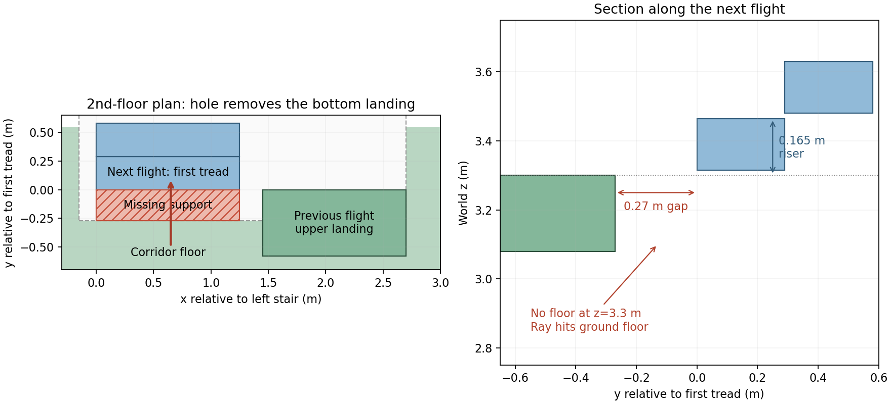

# 복층 실험 연결 수정과 검증

확대 화재 건물에 기존 코드를 연결하면서 앞단의 실패를 먼저 분리했다. 두 정책의 성능을 본 뒤 가치 함수를 조정하지 않았다. 공통 수정 뒤 입력/설정/소스 77개를 동결해 주 비교를 시작했다. 동결 소스 해시는 `results/fire_closed_loop_20261107/main/source_manifest.json`, 복사본은 `source_snapshot/`이다.

| 발생 조건 | 원인과 적용 범위 | 실제 검증 |
|---|---|---|
| 16.5cm 계단이 10cm 복셀 두 행에 걸림 | 그래프의 이웃 높이 검색을 ceil(18cm/res)로 확장하고 실제 표면 높이 차≤18cm를 검사 | 20단 U자 계단의 77노드 자체 생성 경로를 별도 메시 평가기로 유효 확인 |
| 부분 계단/난간 복셀 중심이 실제 발판 밖에 놓임 | 관측된 point 중 셀 중심에 가장 가까운 실제 XY를 보존. 가짜 셀 중심/참 바닥 스냅을 사용하지 않음 | 실제 XY 출력, 난간 돌출 보존, 높이 산포 및 저장/복원 검사 |
| 바닥 표면이 몸 공간의 가장 아래 복셀에도 포함 | 확인된 관측 평면인 OCC 셀만 저층 부분 대역에서 해석. 높이 상한=max(평균+3σ+5mm, 관측 endpoint 최대+5mm)≤발높이+18cm. 발 셀에는 상한≤발높이 필요 | UNKNOWN 몸 공간, 높이 산포, 높은 벽, 미확인 발판과 돌출 장애물 모두 확인 경로를 차단 |
| 부동소수점 10.6/0.1가 105.999… | 동일 고체를 안정적인 floor/ceil ε로 복셀화. 이전 gallery 15cm 복셀 파일은 보존 | 모든 장면의 완전 관측 경로 검증 통과 |
| 정확한 계단 삼각형 모서리의 float32 광선 누락 | 이미 선언한 1mm 접촉 ε 안의 4개 보조 지지 ray만 허용 | 실제 1cm 밖 발판을 끌어오지 않음; 경로 양성 대조군 통과 |
| furniture 중심에 목표/칸막이에 입구 | 정책 실행 전 실제 개구부/방 바닥 영역으로 고정; 고체 형상 불변 | 독립 기준 경로 112개, 모두 메시 유효; 정답 재분류 0건 |
| 예전 후보 고도가 1층 절대 높이만 포함 | 공통 후보 생성기에 관측 FREE 기반 높이 모드 추가 | 정책/참 층 목록 없이 같은 후보 절차 사용 |
| 큰 건물에서 불필요한 몸체/전체 그래프 계산 | 관측 support/후보 전체를 포함한 보수 ROI, 노드 속성 캐시, 도달성의 lazy 이웃 확장 | crop 유무의 노드/경로/구간 중요도 일치 회귀 검사 |
| 회전 잔해를 AABB로 충돌 처리 | 시뮬레이터의 실제 삼각 메시 거리로 기체 구 충돌 판정 | 계획은 관측 지도만 사용; 참 충돌 결과는 실행/평가 쪽에 한정 |
| pair16의 mapping 높이 변수 덮어쓰기 | `for key,z`가 깊이 배열 z를 덮는 지역 변수 오류를 수정 | 실패 로그 보존, 수정된 2대/16초에서 122장·충돌 0; 4대/16초 각 정책 212장·충돌 0 |

옵션 `resolve_low_surface_band`, `use_surface_xy`, `crop_observed_graph`, `height_mode=observed_free`는 이번 설정에서 켠다. 이전 명령의 기본 동작과 레거시 센서 백엔드는 보존한다. 과거 gap 기반 면적 판정기를 이번 확인 그래프에 넣지 않는다. 지지의 2프레임/evidence/산포 규칙과 사람 크기는 유지한다.

완전 관측 검사는 10개 건물의 기준 도달 가능 **112/112개에서 유효 경로**, 잘못된 제시 경로 0개였다. 차단 목표 **100/106개 확인**, 6개 미확인, 잘못된 차단 0개다. 이 값은 검증용 완전 지도 결과이며 드론 탐색 성능과 구분한다. `gates_complete/scene*/targets.csv`와 `reference_checks/scene*/reference_path_validation.csv`에 상세가 있다.

회귀 검사는 기존 72개와 새 복층 8개, 총 80개 통과했다. 동결 직전 그래프 변경 뒤 decision paths(15), 복층(8), short path probe 묶음을 다시 통과했다. 로그는 `audit/test_*_final.log`, `audit/test_*_frozen.log`다. 초기 실패/수정 이력 `preflight_v*`, `local_staircase_v*.log`, 최초 pair16 로그도 보존한다.

센서 연결 고정 위치 검사에서 같은 54,035개 기하학적 유효 픽셀 중 clean 53,630개(99.2505%), strong 52,477개(97.1167%)가 유효했다. 오차 표준편차는 11.81→18.43mm, 절대오차 95백분위 23.43→39.32mm였다. strong의 평균 T는 0.8961이다. 이는 소스 근처 한 고정 위치의 통제 검사이며 모든 실행 평균으로 대체하지 않는다. 같은 시드 재생/고체 셀 밀도 0/비공개 정답 필드 분리를 확인했다.

## 본 실행 중 발견한 장면 생성 결함

3층 건물 5개의 양쪽 2층 계단 10곳 모두에서, 층판의 계단실 구멍 경계와 다음 계단 첫 단 사이에 약 27cm의 바닥 누락을 확인했다. `staircase`는 중간/상부 층계참만 만들고 하부 층계참을 만들지 않는다. 1층 바닥에는 계단실 구멍이 없어 1→2층은 연결되지만 2→3층의 시작 발판이 사라진다. 메시 raycast에서 해당 위치의 지지가 높이 3.3m 대신 약 0m에서 검출됐다. 동결한 원본 장면/진행 중인 정책 실행은 변경하지 않는다. 이 40회는 해당 결함을 포함한 장면의 결과로 보고하며, 3층 도달 능력 검증에 사용하지 않는다. 별도 복사 장면에 하부 층계참만 보완하는 인과 대조 검사를 분리한다.

하부 층계참 2개만 추가한 학교 복사본의 독립 대조 검사를 완료했다. 전체 도달 가능 목표는 14→20개, 3층 도달 가능 목표는 0→6개로 바뀌었고, 20개 양성 경로 모두 별도 메시 평가기로 유효했다. 사람 크기·걸음 높이·판정 설정은 변경하지 않았다. 대조 자료는 `diagnostics/school_landing_control/{summary.json,comparison.csv,reference_targets.json,added_geometry.json}`, 재실행은 `scripts/explore/probe_fire_landings.py --scene 1 --out <새경로>`다. 이 대조의 새 정답을 진행 중인 원본 40회에 섞지 않는다.

