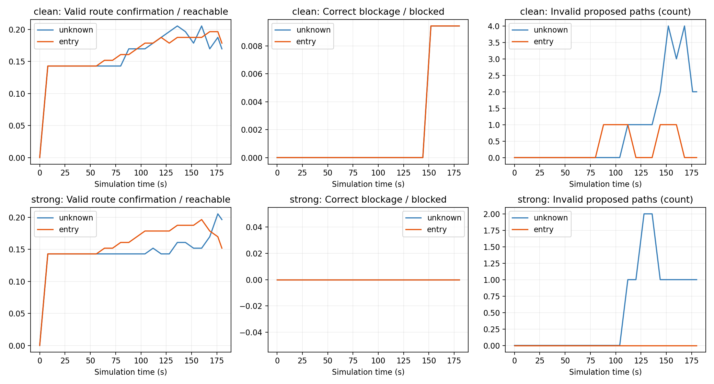
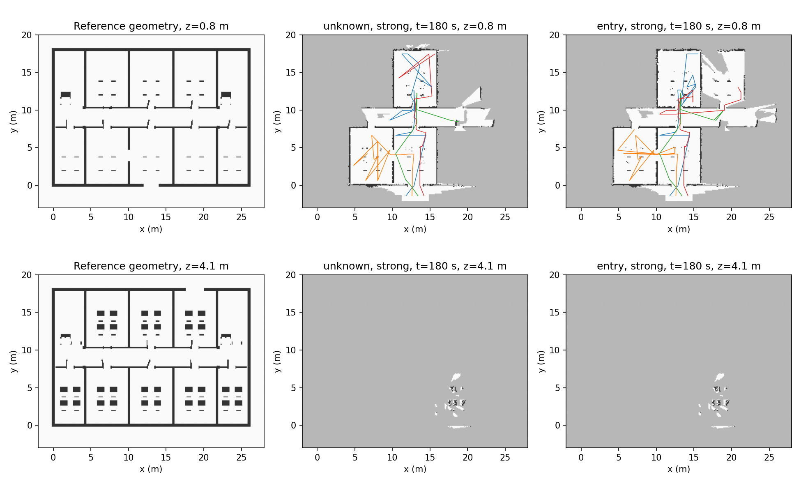
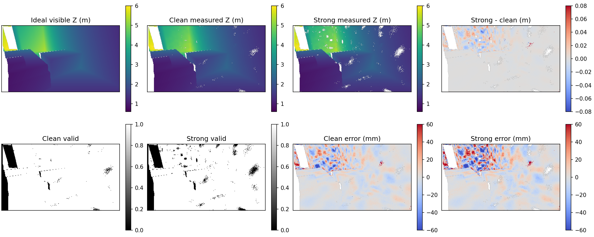

# 복층 확대 화재 건물 폐루프 실험 결과

> **원본 장면의 보존 진단 결과입니다.** 본 실행 중 2층→3층 계단 시작 발판의 27cm 누락을 확인했습니다. 원본의 3층 목표 46개는 전부 기준 차단이어서 3층 진입 능력 검증에 사용할 수 없습니다. [보완 장면 실험](../fire_recon_20261107/METHOD.md)은 별도 형상/정답/실행으로 진행하며, 2층의 동일 실행 20개만 명시적으로 공유합니다. 두 표를 독립한 80회 반복으로 합치지 않습니다.

**10개 건물 × 무연기/강한 저하 × unknown/entry, 총 40회**를 각각 4대·180초·4Hz·perfect_odometry로 완료했다. 주 비교는 공통 다중 드론 탐색 파이프라인에서 관측 가치 함수 비교다. 소스 77개와 설정을 시작 전에 동결했고, 완료 후 해시 일치와 기록 입력 재생을 확인했다.

| 조건 | 정책 | 유효 경로/도달 가능 | 올바른 차단/차단 | 균형 점수 | 무효/검증 경로 | 미확인 | 판정/전체 |
|---|---|---|---|---|---|---|---|
| clean | unknown | 19/112 (16.96%) | 1/106 (0.94%) | 8.95% | 2/21 (9.52%) | 196 | 22/218 (10.09%) |
| clean | entry | 20/112 (17.86%) | 1/106 (0.94%) | 9.40% | 0/20 (0.00%) | 197 | 21/218 (9.63%) |
| strong | unknown | 22/112 (19.64%) | 0/106 (0.00%) | 9.82% | 1/23 (4.35%) | 195 | 23/218 (10.55%) |
| strong | entry | 17/112 (15.18%) | 0/106 (0.00%) | 7.59% | 0/17 (0.00%) | 201 | 17/218 (7.80%) |

분모는 조건·정책별 같은 218개 방 구역이다(기준 도달 가능 112, 차단 106). 무연기도 정상 깊이 오차가 있는 조건이다. 경로가 없는 목표는 자동 차단으로 바꾸지 않았다. 잘못된 경로 비율이 0이어도 적은 제안 수와 낮은 판정률을 함께 해석해야 한다.

## 실제 관측된 차이

- clean: entry−unknown 유효 경로 +1개, 올바른 차단 +0개, 무효 경로 -2개, 균형 점수 +0.45%p.
- strong: entry−unknown 유효 경로 -5개, 올바른 차단 +0개, 무효 경로 -1개, 균형 점수 -2.23%p.

이번 10장면·실행 seed 0의 고정 비교다. 여러 실행 seed의 반복, 통신/포즈 오차, 열·가스 위험은 포함하지 않았다. 실제 화재 안전성이나 실제 장비 성능을 검증한 결과가 아니다.

## 정책이 작동한 범위와 경로 길이

| 조건 | 정책 | entry 대체 규칙 시간 | 양의 entry 후보가 있던 배정 시각 | 전체 배정 시각 | 실제 배정 | 1m 초과 유효 경로 | 상층 실제 궤적 표본 |
|---|---|---|---|---|---|---|---|
| clean | unknown | N/A | 61 | 450 | 383 | 6 | 1559 |
| clean | entry | 1664/1800s | 34 | 450 | 363 | 7 | 1035 |
| strong | unknown | N/A | 80 | 450 | 369 | 9 | 1701 |
| strong | entry | 1548/1800s | 63 | 450 | 374 | 4 | 910 |

대체 규칙 시간은 상태를 평가한 4초 배정 구간의 합이다. 양의 후보가 있어도 비행 경로·예약·최소 작업 유지 조건 때문에 실제 배정을 못 할 수 있다. entry 값이 없는 동안 두 정책은 같은 unknown 규칙을 쓴다. 목표까지 가능 경로가 생기기 전의 넓은 미관측 구간은 현재 구간 절단 점수로 중요도를 부여하기 어렵다. 이를 개선했다고 간주하지 않고 그대로 측정했다.

목표를 방 전체 바닥 영역으로 고정했으므로 입구와 겹친 목표의 한 점/짧은 경로도 주 지표에 포함된다. 보조 열은 길이 1m 초과만 세어 이 효과를 구분한다. 이 보조값은 다른 목표나 더 엄격한 분모로 실험을 다시 선정한 결과가 아니다.

## 실제 운용과 실패

| 조건 | 정책 | 촬영 수 | 팀 이동 거리 합[m] | 실패 기체 | 형상 충돌 | 동료 충돌 기체 이벤트 | 계획 실패 시도 | 실행 예약 대기[s] |
|---|---|---|---|---|---|---|---|---|
| clean | unknown | 25236 | 1685.97 | 9 | 9 | 0 | 6221 | 21.00 |
| clean | entry | 23762 | 1514.87 | 12 | 12 | 0 | 6151 | 18.00 |
| strong | unknown | 25004 | 1699.23 | 10 | 10 | 0 | 5939 | 18.00 |
| strong | entry | 23804 | 1522.78 | 13 | 13 | 0 | 5389 | 17.00 |

동료 충돌은 기체별 이벤트 수로 표시한다. 계획 실패는 후보/배정 시도의 실패이며 임무 전체 실패와 다르다. 실패 드론을 재생성하지 않았고 모든 실행을 최종 분모에 남겼다. 진입 대기는 회당 12 drone·s(출발 전 tick 반올림 항목은 operations.csv 참조)이며 임무 180초 안에 포함된다. CPU 계산 시간은 시뮬레이션 180초보다 길며 실시간 실행을 주장하지 않는다.

## 시각별 전이와 최종 상태

| 조건 | 정책 | 미확인→유효 | 미확인→정차단 | 새 무효 안내 | 통과 취소 | 무효 안내 취소 | 유효 안내 상실 사건 | 이전에 유효했으나 최종 상실 목표 |
|---|---|---|---|---|---|---|---|---|
| clean | unknown | 24 | 1 | 8 | 6 | 2 | 9 | 5 |
| clean | entry | 24 | 1 | 2 | 5 | 1 | 5 | 3 |
| strong | unknown | 27 | 0 | 2 | 6 | 1 | 5 | 3 |
| strong | entry | 22 | 0 | 0 | 5 | 0 | 5 | 5 |

전이 열은 8초 평가와 마지막 시각 사이의 **사건 수**다. 같은 목표가 여러 번 바뀌면 반복 집계된다. 마지막 열만 최종 상태 기준 목표 수다. 최종 표의 경로 수와 사건 수를 혼용하지 않는다.

## 장면별 최종 결과

| 장면 | 조건 | 유효 unknown / entry / R | 정차단 unknown / entry / B | 무효 unknown / entry | 미확인 unknown / entry |
|---|---|---|---|---|---|
| 0 | clean | 1 / 1 / 2 | 0 / 0 / 14 | 0 / 0 | 15 / 15 |
| 0 | strong | 1 / 1 / 2 | 0 / 0 / 14 | 0 / 0 | 15 / 15 |
| 1 | clean | 1 / 2 / 14 | 0 / 0 / 10 | 0 / 0 | 23 / 22 |
| 1 | strong | 1 / 1 / 14 | 0 / 0 / 10 | 0 / 0 | 23 / 23 |
| 2 | clean | 2 / 2 / 17 | 1 / 1 / 13 | 0 / 0 | 27 / 27 |
| 2 | strong | 4 / 2 / 17 | 0 / 0 / 13 | 0 / 0 | 26 / 28 |
| 3 | clean | 2 / 2 / 2 | 0 / 0 / 28 | 0 / 0 | 28 / 28 |
| 3 | strong | 2 / 2 / 2 | 0 / 0 / 28 | 0 / 0 | 28 / 28 |
| 4 | clean | 1 / 1 / 12 | 0 / 0 / 4 | 1 / 0 | 14 / 15 |
| 4 | strong | 5 / 1 / 12 | 0 / 0 / 4 | 0 / 0 | 11 / 15 |
| 5 | clean | 4 / 4 / 16 | 0 / 0 / 0 | 1 / 0 | 11 / 12 |
| 5 | strong | 3 / 2 / 16 | 0 / 0 / 0 | 1 / 0 | 12 / 14 |
| 6 | clean | 1 / 1 / 14 | 0 / 0 / 2 | 0 / 0 | 15 / 15 |
| 6 | strong | 1 / 1 / 14 | 0 / 0 / 2 | 0 / 0 | 15 / 15 |
| 7 | clean | 2 / 2 / 18 | 0 / 0 / 12 | 0 / 0 | 28 / 28 |
| 7 | strong | 2 / 2 / 18 | 0 / 0 / 12 | 0 / 0 | 28 / 28 |
| 8 | clean | 1 / 1 / 1 | 0 / 0 / 15 | 0 / 0 | 15 / 15 |
| 8 | strong | 1 / 1 / 1 | 0 / 0 / 15 | 0 / 0 | 15 / 15 |
| 9 | clean | 4 / 4 / 16 | 0 / 0 / 8 | 0 / 0 | 20 / 20 |
| 9 | strong | 2 / 4 / 16 | 0 / 0 / 8 | 0 / 0 | 22 / 20 |

장면 5의 B=0은 N/A이며 균형 점수의 장면 평균에서 몰래 제외하거나 0으로 바꾸지 않았다. 주 표는 모든 장면의 고정 분모를 합산한 점수다.

회색은 미관측, 흰색은 관측 FREE, 짙은색은 OCC다. 층을 구분한 동일 z 단면이며 여러 층을 한 XY 평면에 합치지 않았다.

## 앞단 검증과 해석의 한계

완전 관측의 공통 판정기에서 유효 경로 112/112, 올바른 차단 100/106, 무효 경로 0이었다. 차단 6개는 완전 지도에서도 보수적 증명 부족으로 미확인이다. 드론 부분 지도에서의 낮은 확인률을 정답 경로 생성기 자체의 전면 실패로 해석하지 않는다.

정답의 차단 라벨은 독립 메시 기반 10cm 지지 로드맵 기준이다. 연속 공간의 모든 미세 우회를 배제한 해석적 증명은 아니다. 정책 제시 경로의 독립 검증과 기준 라벨 모순을 별도 감사했다: **0건**. 완전 지도 합격, 부분 지도의 확인, 기준 라벨 모순은 각각 별개의 검사다.

실제 관측 입력 97,806장, 80개 선택 프레임의 깊이/sigma/valid 재생 일치, 모든 정책 쌍의 첫 관측 일치, 동결 소스 77개 불변을 확인했다. 저장된 깊이 276장만으로 20초 지도를 다시 적분해 모든 배열이 비트 단위로 같았다.

확대 화재 75개 소스가 같은 3D 연기장과 깊이 저하에 연결돼 있다. 이는 무차원 확산장과 지정된 오차 분포이며 실제 화재 농도로 환산하지 않는다. 온도·가스·건물 붕괴의 동역학, 화염 자체의 깊이 산란, 실제 카메라 영상 처리는 제외했다. 카메라는 낙관적 가상 모델이고 완전 위치/즉시 통신을 가정한다.

구체적인 수정 범위와 실패 기록은 [FIXES](FIXES.md), 센서·기체·사람·분모 정의는 [METHOD](METHOD.md), 실행/재생은 [REPRODUCE](REPRODUCE.md)에 있다.

## 결과 파일

- [방식별 집계 CSV](data/summary_by_method.csv) · [40회 최종 CSV](data/runs_final.csv) · [쌍별 차이](data/paired_comparison.csv)
- [목표·경로 상세](data/targets_final.csv) · [짧은 경로 표](data/paths_final_compact.csv) · [전이 집계](data/temporal_goal_summary.csv)
- [정책 활성/대체 규칙](data/policy_activity.csv) · [실제 배정 차이](data/paired_assignment_audit.csv) · [운용/실패](data/operations.csv)
- [시각별 지표](data/metrics_time_all.csv) · [깊이 유효율/오차](data/sensor_observations.csv) · [지도 수](data/map_counts.csv)
- 재생 입력: `results/fire_closed_loop_20261107/main/scene*_seed0_{clean,strong}_{unknown,entry}/`의 깊이 NPZ·frames.csv·trajectories.csv·maps·replay_manifest.json
- 선택 로그: 같은 실행 폴더의 candidates.jsonl, assignments.jsonl, decisions.jsonl. 후보 선택 뒤 관측 생성 순서는 selection_before_sensor에 명시한다.
- 감사: `results/fire_closed_loop_20261107/audit/main_checks.json`, 기준/검증: `reference_final`, `reference_checks`, `gates_complete`.

## 유효 깊이 0개 촬영의 통계 처리

97,806장 중 5,182장은 유효 깊이 0개로 기록됐다. 이 프레임의 오차는 N/A이며 오차 풀링 가중치는 0이다. 실제 촬영 수·시간·비용에는 포함했다. 최초 후처리의 빈 통계 칸 파싱 실패와 버전 분리한 수정 로그를 보존했다. 원본 CSV·깊이·지도·후보·판정은 변경하지 않았다. [0개 프레임 CSV](data/zero_valid_frames.csv), `audit/postprocess_v2.log`와 `postprocessing_zero_valid_manifest.json`을 참조한다.
