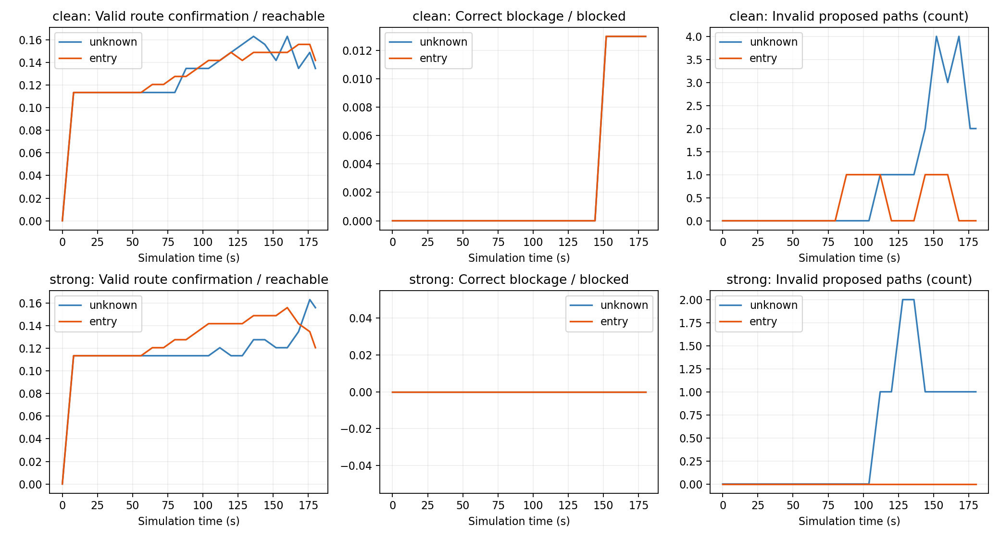
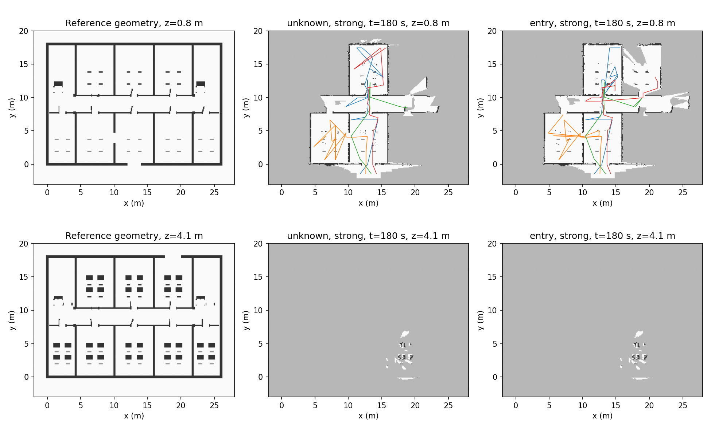

# 소방관 진입 판단 중심의 관측 가치 비교 — 보완 복층 화재 장면

10개 건물 × clean/strong × unknown/entry의 **40개 조건**을 4대·180초·4Hz·perfect_odometry로 평가했다. 이 중 20회는 보완된 3층 건물에서 새로 실행했고, 20회는 형상과 모든 핵심 처리/수치 설정이 같은 2층 건물의 실행을 재사용했다. 실패 실행을 제외하지 않았다.

**현재 결론:** 무연기에서는 entry가 유효 경로1개를 더 확인하고 무효 안내2개를 줄였지만, 강한 관측 저하에서는 유효 경로5개를 덜 확인했다. 일관된 우위는 확인하지 못했다. 전체 목표의 약89–92%가 최종 미확인이며2·3층 유효 경로는 양쪽 모두0이다.

주 비교는 **공통 다중 드론 탐색 파이프라인에서 관측 가치 함수 비교**다. 목표는 지정된 사람 크기/자세로 수색 구역에 기하학적으로 도착하는 경로의 확보이며, 방 전체 수색이나 화재 안전성을 판정한 것은 아니다.

| 조건 | 정책 | 유효/R | 정차단/B | 균형 점수 | 무효/검증 제안 | 전체 제안 | 검증 불가 | 미확인 | 판정/전체 | 차단 오판 |
|---|---|---|---|---|---|---|---|---|---|---|
| clean | unknown | 19/141 (13.48%) | 1/77 (1.30%) | 7.39% | 2/21 (9.52%) | 21 | 0 | 196 | 22/218 (10.09%) | 0 |
| clean | entry | 20/141 (14.18%) | 1/77 (1.30%) | 7.74% | 0/20 (0.00%) | 20 | 0 | 197 | 21/218 (9.63%) | 0 |
| strong | unknown | 22/141 (15.60%) | 0/77 (0.00%) | 7.80% | 1/23 (4.35%) | 23 | 0 | 195 | 23/218 (10.55%) | 0 |
| strong | entry | 17/141 (12.06%) | 0/77 (0.00%) | 6.03% | 0/17 (0.00%) | 17 | 0 | 201 | 17/218 (7.80%) | 0 |

조건·정책별 같은 목표 218개, 기준 도달 가능 141개·차단 77개가 분모다. 유효 경로 확인율과 올바른 차단율의 평균이 균형 점수다. 무효 경로 비율은 무효/(유효+무효로 검증한 제안)이며 분모 0이면 N/A다. 미확인은 성공으로 세지 않는다.

## 현재 entry가 도움이 되었는가

- clean: entry−unknown 유효 경로 +1, 올바른 차단 +0, 무효 안내 -2, 차단 오판 +0. 균형 점수 차이는 +0.35%p다. 유효 경로 수 기준 장면별 우세/동률/열세는 1/9/0곳이다.
- strong: entry−unknown 유효 경로 -5, 올바른 차단 +0, 무효 안내 -1, 차단 오판 +0. 균형 점수 차이는 -1.77%p다. 유효 경로 수 기준 장면별 우세/동률/열세는 1/6/3곳이다.

실행 seed는 0 하나다. 위 수치는 이번 고정 장면/시간/관측 모델의 쌍 비교이며 통계적·실화재 일반 우위를 확정하지 않는다. 오류율이 낮더라도 제안 수와 판정률이 낮으면 성공으로 해석하지 않는다.

## 가치 계산과 짧은 경로의 영향

| 조건 | 정책 | entry 대체 시간 | 양의 entry 후보가 있던 시각/배정 시각 | 실제 배정 수 | 한 점 유효 경로 | 1m 초과 유효 경로 | 상층 궤적 표본 |
|---|---|---|---|---|---|---|---|
| clean | unknown | N/A | 61/450 | 383 | 13 | 6 | 1559 |
| clean | entry | 1664/1800s | 34/450 | 363 | 13 | 7 | 1035 |
| strong | unknown | N/A | 81/450 | 369 | 13 | 9 | 1701 |
| strong | entry | 1548/1800s | 63/450 | 374 | 13 | 4 | 910 |

entry 대체 시간은 양의 값이 없을 때 공통 unknown 규칙으로 돌아간 배정 구간의 합이다. 같은 목표의 여러 미확인 구간을 각각 확인해야 할 때 구간 중요도만으로 경로 완성을 보장하지 않는다. `decision_graph_coverage.csv`에는 가능 경로·구간 검사·양의 후보가 존재한 실제 상태를 기록했다.

목표 영역은 방 전체 바닥 내부(경계 5cm 제외)로 고정했다. 입구와 겹치는 구역은 한 점/짧은 경로로도 도착할 수 있으므로 보조 열로 이를 공개한다. 보조 길이 구분으로 주 지표의 목표나 분모를 바꾸지는 않았다.

## 운용 비용과 실패

| 조건 | 정책 | 촬영 | 팀 거리 합[m] | 실패 기체 | 형상 충돌 | 동료 충돌 기체 이벤트 | 계획 실패 시도 | 실행 예약 대기[s] |
|---|---|---|---|---|---|---|---|---|
| clean | unknown | 25236 | 1685.97 | 9 | 9 | 0 | 6221 | 21.00 |
| clean | entry | 23762 | 1514.87 | 12 | 12 | 0 | 6151 | 18.00 |
| strong | unknown | 25004 | 1699.23 | 10 | 10 | 0 | 5939 | 18.00 |
| strong | entry | 23804 | 1522.78 | 13 | 13 | 0 | 5389 | 17.00 |

충돌 기체는 마지막 안전 위치에 고정하고 나머지를 계속 운용했다. 재생성/실패 제외는 없다. 계획 실패는 후보/예약 시도의 실패이며 임무 전체 실패와 다르다. 동료 충돌 열은 기체별 이벤트 수다. 시뮬레이션 시간과 CPU 벽시계를 구분하며 실시간 구동을 주장하지 않는다.

## 시간별 전이

| 조건 | 정책 | 미확인→유효 | 미확인→정차단 | 새 무효 안내 | 통과 취소 | 무효 안내 취소 | 유효 안내 상실 사건 | 최종 유효 상실 목표 |
|---|---|---|---|---|---|---|---|---|
| clean | unknown | 24 | 1 | 8 | 6 | 2 | 9 | 5 |
| clean | entry | 24 | 1 | 2 | 5 | 1 | 5 | 3 |
| strong | unknown | 27 | 0 | 2 | 6 | 1 | 5 | 3 |
| strong | entry | 22 | 0 | 0 | 5 | 0 | 5 | 5 |

평가 간격 8초와 마지막 시각의 전이 사건 수다. 같은 목표가 반복해서 바뀌면 사건은 반복 집계되며 마지막 열만 최종 고유 목표 수다. 연속 시간의 모든 중간 상태까지 검사했다고 해석하지 않는다.

## 장면별 최종 결과

| 장면 | 조건 | 출처 | 유효 unknown / entry / R | 정차단 unknown / entry / B | 무효 unknown / entry | 미확인 unknown / entry |
|---|---|---|---|---|---|---|
| 0 | clean | 동일 실행 재사용 | 1 / 1 / 2 | 0 / 0 / 14 | 0 / 0 | 15 / 15 |
| 0 | strong | 동일 실행 재사용 | 1 / 1 / 2 | 0 / 0 / 14 | 0 / 0 | 15 / 15 |
| 1 | clean | 새 실행 | 1 / 2 / 20 | 0 / 0 / 4 | 0 / 0 | 23 / 22 |
| 1 | strong | 새 실행 | 1 / 1 / 20 | 0 / 0 / 4 | 0 / 0 | 23 / 23 |
| 2 | clean | 새 실행 | 2 / 2 / 25 | 1 / 1 / 5 | 0 / 0 | 27 / 27 |
| 2 | strong | 새 실행 | 4 / 2 / 25 | 0 / 0 / 5 | 0 / 0 | 26 / 28 |
| 3 | clean | 새 실행 | 2 / 2 / 2 | 0 / 0 / 28 | 0 / 0 | 28 / 28 |
| 3 | strong | 새 실행 | 2 / 2 / 2 | 0 / 0 / 28 | 0 / 0 | 28 / 28 |
| 4 | clean | 동일 실행 재사용 | 1 / 1 / 12 | 0 / 0 / 4 | 1 / 0 | 14 / 15 |
| 4 | strong | 동일 실행 재사용 | 5 / 1 / 12 | 0 / 0 / 4 | 0 / 0 | 11 / 15 |
| 5 | clean | 동일 실행 재사용 | 4 / 4 / 16 | 0 / 0 / 0 | 1 / 0 | 11 / 12 |
| 5 | strong | 동일 실행 재사용 | 3 / 2 / 16 | 0 / 0 / 0 | 1 / 0 | 12 / 14 |
| 6 | clean | 동일 실행 재사용 | 1 / 1 / 14 | 0 / 0 / 2 | 0 / 0 | 15 / 15 |
| 6 | strong | 동일 실행 재사용 | 1 / 1 / 14 | 0 / 0 / 2 | 0 / 0 | 15 / 15 |
| 7 | clean | 새 실행 | 2 / 2 / 25 | 0 / 0 / 5 | 0 / 0 | 28 / 28 |
| 7 | strong | 새 실행 | 2 / 2 / 25 | 0 / 0 / 5 | 0 / 0 | 28 / 28 |
| 8 | clean | 동일 실행 재사용 | 1 / 1 / 1 | 0 / 0 / 15 | 0 / 0 | 15 / 15 |
| 8 | strong | 동일 실행 재사용 | 1 / 1 / 1 | 0 / 0 / 15 | 0 / 0 | 15 / 15 |
| 9 | clean | 새 실행 | 4 / 4 / 24 | 0 / 0 / 0 | 0 / 0 | 20 / 20 |
| 9 | strong | 새 실행 | 2 / 4 / 24 | 0 / 0 / 0 | 0 / 0 | 22 / 20 |

B=0인 장면의 차단율/균형 점수는 N/A다. 해당 실행을 제외하지 않으며, 주 표는 고정된 전체 목표 분모를 합산한다.

## 장면 보완·재사용·검증 범위

원본 장면의 2층→3층 하부 층계참 누락(27cm 틈)을 발견해 원본을 보존하고 3층 건물 5개에 발판 10개만 보완했다. 독립 기준의 3층 도달 가능 목표는 0→29개다. 보완 장면 완전 관측에서는 유효 경로 141/141, 올바른 차단 71/77, 무효 0이다. 나머지 차단 6개는 보수적 증명 부족으로 미확인이다. 기준 검증과 실제 드론 부분 지도 성능은 서로 다른 결과다.

형상이 그대로인 2층 건물의 20회는 핵심 모듈/수치 설정/실제 메시/사전 구역 일치를 확인했고, 60개 관측을 새 어댑터에서 Z/sigma/valid까지 비트 동일하게 재생한 뒤 포함했다. 원본 메타데이터는 복사하고 큰 깊이/지도 폴더는 참조 링크로 두어 덮어쓰지 않았다. 재사용을 새 반복 실행으로 세지 않으며 모든 실패도 포함한다. 원본 40회는 별도 진단 결과로 보존한다.

전체 입력 97,806장과 80개 감사 표본의 센서 재생 일치, 모든 정책 쌍의 첫 측정 일치, 배정 지도 버전/후보 집합/실패 기체 정지 유지, 동결 소스 106개 불변을 확인했다. 부분 지도에서 독립 검증한 유효 경로와 기준 라벨의 모순은 0건이며 `audit/main_checks.json`에 남겼다.

기준 차단은 완전 메시의 지지/몸체를 검사하는 10cm 로드맵 기준이다. 연속 공간의 모든 미세 우회를 배제한 해석적 증명은 아니다. 제시 경로를 더 좋은 참 경로로 대체하지 않고 시작/층/목표·지지·18cm 걸음·자세·몸체 sweep으로 직접 검증했다.

입력은 서버에서 확인한 기존 `web/fire_buildings_3d.html`의 확대 화재 10개와 동일한 실제 PLY/충돌 형상 및 별도 보완본이다. 요청 이름 `fire_buildings_3d(1).htm`은 발견되지 않아 그 파일 자체의 동일성은 확인하지 못했다. 수신 메시지는 §2의 후보 생성 절차/수 제한까지였으며, 이후 조건을 받았다고 간주하지 않았다. 적용 범위를 이 실제 입력과 고정 설정으로 제한한다.

RealSense D455급 공개 사양을 참고한 낙관적 깊이 관측 모델과 통제된 저하 조건이다. 75개 소스의 무차원 연기장과 오류 분포이며 실제 화재/실물 카메라/SGBM을 재현한 결과가 아니다. 열·가스·구조 안정성·피해자 운반·통신 지연·비행 자세 제어는 별도 모델이 없다. 이번 정답은 지정한 사람의 기하학적 도착 가능성이다.

## 산출물

- [방식별 집계](data/summary_by_method.csv) · [실행별 최종](data/runs_final.csv) · [쌍별 차이](data/paired_comparison.csv)
- [목표·제시 경로 상세](data/targets_final.csv) · [경로 길이 요약](data/paths_final_compact.csv) · [시간별 지표](data/metrics_time_all.csv)
- [가치/대체 규칙](data/policy_activity.csv) · [가능 경로/중요도 범위](data/decision_graph_coverage.csv) · [실제 배정 차이](data/paired_assignment_audit.csv)
- [기체 운용](data/operations.csv) · [센서 관측 품질](data/sensor_observations.csv) · [전이](data/temporal_goal_summary.csv)
- 설정/정답/실제 자산/소스: `results/fire_recon_20261108_resume/{evaluation_cases.json,assets,gates_complete,main/source_manifest.json,main/source_snapshot}`
- 실제 촬영/포즈/지도/선택: 각 main 실행의 frames NPZ·frames.csv·trajectories.csv·maps·replay_manifest.json·candidates.jsonl·assignments.jsonl·decisions.jsonl
- 재사용 증명: `main/reuse_checks.json`, `main/reuse_observation_replays.csv`, 각 실행 reuse_provenance.json
- [방법](METHOD.md) · [재실행](REPRODUCE.md) · [자료 인수](INTAKE.md) · [작은 실제 검증](PREFLIGHT.md).

## 층별 최종 경로 확인

| 조건 | 정책 | 층 | 유효/R | 정차단/B | 미확인 | 실내 촬영 | 유효 깊이 있는 촬영 |
|---|---|---|---|---|---|---|---|
| clean | entry | 1 | 20/60 | 1/26 | 65 | 20818 | 20009 |
| clean | entry | 2 | 0/52 | 0/34 | 86 | 994 | 950 |
| clean | entry | 3 | 0/29 | 0/17 | 46 | 0 | 0 |
| clean | unknown | 1 | 19/60 | 1/26 | 64 | 21768 | 20948 |
| clean | unknown | 2 | 0/52 | 0/34 | 86 | 1518 | 1454 |
| clean | unknown | 3 | 0/29 | 0/17 | 46 | 0 | 0 |
| strong | entry | 1 | 17/60 | 0/26 | 69 | 20944 | 20206 |
| strong | entry | 2 | 0/52 | 0/34 | 86 | 910 | 815 |
| strong | entry | 3 | 0/29 | 0/17 | 46 | 0 | 0 |
| strong | unknown | 1 | 22/60 | 0/26 | 63 | 21445 | 20531 |
| strong | unknown | 2 | 0/52 | 0/34 | 86 | 1638 | 1519 |
| strong | unknown | 3 | 0/29 | 0/17 | 46 | 63 | 63 |

층은 사전에 고정한 목표 도착 층이다. 드론이 위층 높이에서 촬영한 것과 입구부터 사람 경로를 확인한 것을 구분한다. 전체 목표를 그대로 나눈 표이며 결과에 따라 목표/분모를 바꾸지 않았다.

## 실행 중단과 정확한 재개

2026-11-08 00:45 무렵 계산 프로세스가 종료되어 원래 보완 20회의 약96–128초 기록을 보존했다. 기록된 현재 시각·드론·카메라/동료 포즈가 일치하는 깊이만 재생해 내부 상태를 재구성하고 나머지 가상 시간을 실행했다. 캐시 관측은 각 프레임 ID당 한 번 적분했으며 새 독립 관측이나 추가 시간 예산으로 세지 않았다. 관측 가치·센서 수치·배정·이동·사람 판정의 알고리즘은 유지했다.

공통 runner의 선택형 실행 I/O에 확률을 보존하는 OctoMap .ot, 표면 누적 모멘트/투표/증거, 기체/예약 궤적, 카운터와 로그 위치를 저장하는 원자적 체크포인트를 추가했다. 파괴적인 .bt 형식은 쓰지 않는다. 중단 전 동결 코드의 연속 실행과 캐시 재생 중단/복구 실행을 비교해27관측의 지도 전체 배열·궤적·이벤트·후보/배정·목표 경로/지표가 정확히 같음을 검증했다(`validation/execution_v1/verification.json`).

유효 깊이0개 프레임의 원래 오차는 N/A이며 오차 풀링 가중치는0이다. raw CSV/깊이/지도/판정은 수정하지 않고 별도 count-aware 후처리를 적용했다. [0개 프레임 CSV](data/zero_valid_frames.csv). CPU 시간에는 재생과 상태 저장이 포함되므로 카메라를 매번 새로 렌더한 비용과 혼동하지 않는다. 주 시간축은 동일한180초의 가상 임무다.

## 부분 지도의 첫 단절과 무효 안내 사례

사전 연결 검사에 사용한 학교(scene1)를 그대로 선택해 clean/strong × unknown/entry의 최종 지도에 독립 기준 경로를 대조했다. 아래는 시스템이 아직 통과 가능으로 답하지 않은 도달 가능 목표들에 대해, 그 특정 기준 경로에서 처음 부족한 단계다. 대체 경로 전체의 불가능 증명이 아니며 정답을 지도나 정책에 반영하지 않았다.

| 실행 | 미확인 양성 목표 | 첫 단절 단계와 개수 |
|---|---|---|
| scene1_seed0_clean_unknown | 19 | next_support_connection: 19 |
| scene1_seed0_clean_entry | 18 | next_support_connection: 18 |
| scene1_seed0_strong_unknown | 19 | next_support_connection: 19 |
| scene1_seed0_strong_entry | 19 | next_support_connection: 19 |

[첫 실패 좌표·발판 증거·높이·자세의 상세 CSV](data/reference_route_first_break.csv). 완전 관측에서는 학교의 유효 경로20/20과 차단4/4가 확인된 것과 구분한다.

무효 안내의 한 예는 `scene4_seed0_clean_unknown` / `L1_0_1`다. 목표의 기준 도달 가능 여부는 `True`지만, 실제 제시 경로는 `[12.548266410827637, 7.324999786376953, 0.20775312418341635]`에서 `mesh_body_collision`로 실패했다. 목표에 다른 경로로 도달할 수 있어도 이 안내는 무효로 유지했다. 전체 최종 무효 안내 3건은 [실패 위치 CSV](data/invalid_route_examples.csv)에 있다.

## 보완 장면과 원본 실행을 직접 대조한 결과

보완된3층20회 모두 원본과 실제 궤적·촬영 수·이동 거리·실패 기체·최종 확인 건수가 같았다. 최종 지도12/20개는 실제로 달랐으며(labels/점유 endpoint 높이, 일부 표면 증거 등), 나머지8개는 모든 지도 필드가 같았다. 따라서 누락 발판을 보완한 효과를 관측 정책의 개선으로 주장하지 않는다. 입력 기하의 결함을 없앤 뒤에도 제한 시간의 관측과 확인 연결이 충분하지 않았다. [조건별 지도·궤적 직접 비교](data/geometry_repair_comparison.csv). 모든 깊이를 비교했다는 뜻은 아니며, 전체 최종 지도 배열과 궤적 및 주요 지표를 대조했다.

본 비교의 확인된 경로는 전부1층이다. 상층 비행이나 위층의 일부 빈 공간을 본 것만으로 입구부터 사람 경로가 확인되지는 않는다. 학교의 사후 검사75개 미확인 양성 사례는 선택한 독립 기준 경로의 `next_support_connection` 단계에서 처음 끊겼다. 이는 발판 증거만 늘리면 반드시 해결된다는 결과가 아니며, 걸음·대각선 모서리·실제 관측XY 사이 연결 검사까지 남은 공통 병목임을 보여준다. 특정 기준 경로의 진단이므로 모든 대체 경로가 같은 지점에서 끊긴다는 증명은 아니다.

entry는 clean1664/1800초(92.44%), strong1548/1800초(86.00%)를 공통 unknown 규칙으로 대체했다. 양의 entry 점수가 없던 구간과, 점수가 있어 실제 배정이 달라진 구간을 후보/배정 로그로 구분했다. 현재 구현에서는 먼 목표로 이어지는 가능 경로가 성립하지 않을 때 중요 구간의 목표 영향도도 계산되지 않는 문제가 관찰된다. 이 결과를 보고 정책 가중이나 목표 분모를 바꾸지 않았다.

이번에 추가한 것은 실행 재개·사후 통계·진단 I/O다. `execution_state.py`, runner의 선택형 execution, `run_fire_recon_resumable.py`, `run_recon_resumable_matrix.py`, `validate_execution_resume.py`와 두 finish 셸을 사용했다. 장면 보완은 opt-in `fire_recon_scene.py`이며, 상세 변경·원본 보존은 [FIXES](FIXES.md), 현재 실행 명령은 [RESUME](RESUME.md)에 있다.
